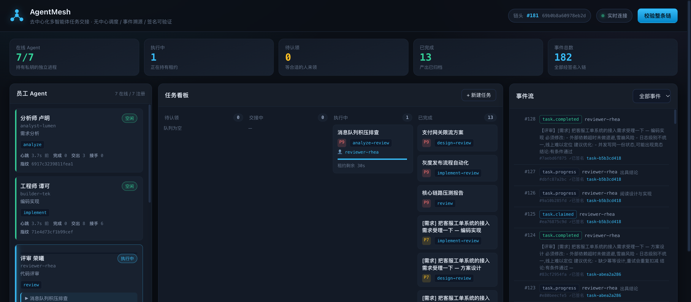
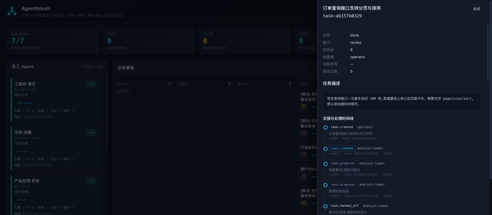
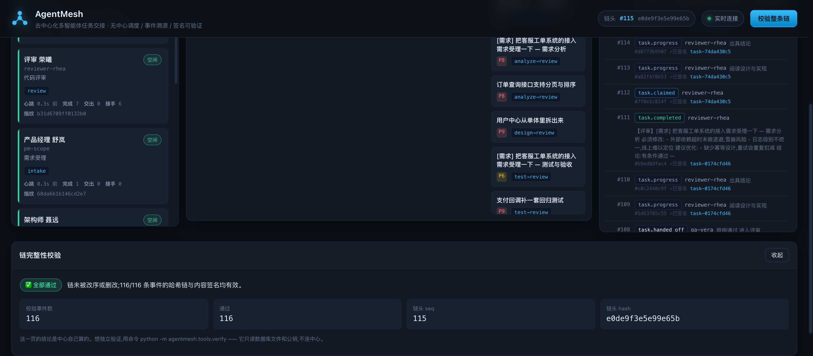

# AgentMesh

> 去中心化多智能体任务交接系统 —— 一位员工一个 Agent 进程,任务靠**认领**而不是**指派**,
> 每一次交接都留签名,**任何人(包括中心自己)都改不了历史**。



---

## 它到底解决什么

多 Agent 系统最容易失控的三件事,这个项目逐条对症:

| 常见问题 | 这里的做法 |
|---|---|
| 中心调度器单点,谁忙谁闲全靠它猜 | **没有调度器**。Agent 自己来问"有没有我能干的活",中心只做原子裁决 |
| Agent 崩了,任务被它锁死,没人知道 | **租约**。到期自动回队列,写一条 `task.released`,没人来救也能自愈 |
| Agent 之间黑箱交接,出了问题查不到 | **每步签名上链**,交接理由、上下文、能力跃迁全程可追 |
| 中心可以悄悄改数据/删记录 | **哈希链 + 内容签名双层**,中心失陷也伪造不出 Agent 的行为 |

---

## 60 秒跑起来

需要 **Python 3.11+**(推荐 3.12/3.13)。

```bash
# 1. 依赖(只有 4 个包)
python3 -m venv .venv
.venv/bin/pip install -r requirements.txt

# 2. 一键起:中心 + 7 个 Agent + 一批任务
./run_demo.sh

# 3. 打开看板
open http://127.0.0.1:8765/
```

> **装不上依赖?** 报 `Could not find a version that satisfies the requirement fastapi
> (from versions: none)` 基本都是镜像问题 —— 部分国内镜像对 Python 3.14 返回空的
> 版本列表。换个源即可:
> ```bash
> .venv/bin/pip install -r requirements.txt -i https://pypi.org/simple
> ```
> 或者直接用 Python 3.12/3.13 建虚拟环境。

停掉:`./stop_demo.sh`。想从零重来:`./run_demo.sh --reset`。

验证这条链是真的(不需要连中心):

```bash
.venv/bin/python -m agentmesh.tools.verify   # 离线校验整条链
.venv/bin/python -m agentmesh.tools.tamper   # 三种攻击演示,看能不能被发现
./run_tests.sh                                # 24 个测试
```

---

## 跑起来之后你会看到什么

七位"员工",七把私钥,七个独立进程:

| Agent | 岗位 | 能力 |
|---|---|---|
| `pm-scope` | 产品经理 舒岚 | `intake` 需求受理 —— 能**自己长出**后续任务 |
| `analyst-lumen` | 分析师 卢明 | `analyze` |
| `architect-nova` | 架构师 聂远 | `design` |
| `builder-tek` | 工程师 谭可 | `implement` |
| `qa-vera` | 测试 韦安 | `test` |
| `reviewer-rhea` | 评审 荣曦 | `review` |
| `writer-lyra` | 文档 柳砚 | `docs` |

一条"订单查询接口支持分页"的任务,会自己走完这条链路:

```
operator 创建 (cap=analyze)
   └─ analyst-lumen  认领  →  需求分析  →  交接(下一步需要 design)
        └─ architect-nova 认领 → 架构设计 → 交接(下一步需要 implement)
             └─ builder-tek  认领 → 编码实现 → 交接(下一步需要 test)
                  └─ qa-vera 认领 → 测试验收 → 交接(下一步需要 review)
                       └─ reviewer-rhea 认领 → 评审 → 完成
```

每一步的交接理由、上下文、签名都在链上,点任务卡片就能看完整时间线:



---

## "可验证"不是口号 —— 当场证明给你看

系统的安全性主张很容易变成空话,所以把攻击写成了可复现的脚本。

`python -m agentmesh.tools.tamper` 在日志**副本**上做三种攻击,每次都用离线校验器复验:

```
【攻击 A】把事件的 payload 改成"已完成"
  校验器:❌ 被抓住
      seq 46 [invalid_event] hash 不符:重算 4bc94169c7d0 ≠ 存储 29f140577102

【攻击 B】同上,并把 hash、后续所有 prev_hash 全部重算,
          再用中心私钥把整条链重新签一遍 —— 中心被完全攻陷
  校验器:❌ 被抓住
      seq 46 [invalid_event] 内容签名无效:签名与公钥不匹配(内容被改过…)
      ↑ 哈希层和中心签名都被修好了,抓它的是 Agent 自己的内容签名:
        中心没有 Agent 私钥,签不出来。

【攻击 C】删掉中间一条事件(抹掉失败/异常记录)
  校验器:❌ 被抓住
      seq 48 [broken_link] prev_hash=864b042ad8cd ≠ 前一条 hash=29f140577102

✅ 3/3 种攻击全部被检出 —— 可验证,已证实
```

看板右上角的「校验整条链」按钮跑的就是同一套校验,点开能看到每个事件逐条通过:



> 攻击 B 这个演示是有来历的。早期版本里 Agent 签的是 `intent`、正文放在未签名的
> `payload` 里,中心改 `payload` 再重算整条链,校验器**完全看不出来**。
> 现在签名直接覆盖内容本体,这个洞才算真正堵上。

### 双层完整性

```
hash = sha256(canonical({prev_hash, seq, ts, type, actor, task_id,
                         payload, server, attest_sig, attest_task_id, alg}))
```

- **哈希层**回答"历史上有没有被动手脚" —— 改一个字节、删一条、插一条,后面全部对不上。
- **内容签名层**回答"这事到底是谁干的、内容是不是他说的" ——
  `attest_sig` 是 Agent 私钥对 `canonical({actor, type, task_id, payload})` 的签名。
  中心有中心私钥(能重签链),但没有 Agent 私钥,所以伪造不出 Agent 的行为。

`payload` 是**被签名的那份内容**;`server` 放中心补充的事实(租约到期、重试次数),
两者都在哈希内但只有前者被签名。这个划分是刻意的 —— 把用户可见的内容放进
未签名的字段,就等于没签。

---

## 去中心化到什么程度(诚实版)

**真的去中心化:**

- 任务分配是认领制,中心不知道谁擅长什么,也没有"派单"接口
- 能力协商在 Agent 之间完成:做完了自己判断"下一步需要什么能力",按能力找同伴
- 工作可以自己长出来:`intake` 能力做完会创建新任务,中心只验签放行
- 崩溃自愈:租约到期任务自动回队列,不依赖中心做任何干预
- 每个 Agent 本地留完整事件副本并**独立验签**,中心不可信时系统仍可审计
- 交接是意向不是命令:指名的人不领,窗口一过任何合适的人都能接

**仍然是中心的部分(以及为什么):**

- SQLite 写日志和裁决认领。跨主机要换 Postgres,见 [CLOUD.md](CLOUD.md)
- 中心持有自己的私钥,能决定**写入顺序**和**时间戳**。
  也就是说:它可以把两条事件的先后倒过来,但改不了内容、删不掉、改不掉哈希链接
  —— 想删就得重签整条链,重签了链尾 hash 就变,对不上任何人手里的链头。
- 没有可信时间戳服务(timestamping authority),所以"这件事发生于几点"
  是中心说了算的。要根治得接 RFC3161 时间戳服务,已列入待办。

一句话:**内容去中心化,顺序还差最后一口气。** 详见 [ARCHITECTURE.md](ARCHITECTURE.md)。

---

## 换成你自己的业务

内置的 `intake/analyze/design/implement/test/review/docs` 都是**模拟能力**
(生成结构化文本,不调外部服务),目的是让整条链路跑得起来看得见。

换成真实能力只要动一个文件 —— `agentmesh/capabilities.py` 的注册表:

```python
def my_capability(agent, task, report):
    report.progress("正在调用模型…", 30)
    result = call_your_llm(task["description"])
    return Outcome(
        kind=OUTCOME_HANDOFF,          # 做完交给谁
        result=result,
        next_capability="review",      # 下一步需要什么能力
        reason="代码写完了,帮我看看",
        note="重点看并发那条路径",
        context={"commit": "abc123"},  # 交接时带过去的上下文
    )

CAPABILITY_REGISTRY["my_capability"] = my_capability
```

然后启动时声明能力即可:`--capabilities my_capability,review`。
运行时、协议、看板、验证器**都不用改**。

---

## 常用命令

```bash
# 起中心(生产建议只监听内网,前面挂 nginx + TLS)
.venv/bin/python -m agentmesh.hub --host 0.0.0.0 --port 8765

# 起一个 Agent
.venv/bin/python -m agentmesh.agent \
    --id qa-vera --name "测试 韦安" --role 测试验证 \
    --capabilities test --hub http://127.0.0.1:8765

# 灌任务
.venv/bin/python -m agentmesh.tools.seed
curl -X POST localhost:8765/api/tasks -H 'Content-Type: application/json' \
     -d '{"title":"加个分页","required_capability":"backend","priority":8}'

# 校验
curl localhost:8765/api/verify | python3 -m json.tool
.venv/bin/python -m agentmesh.tools.verify --json
```

API 全量文档:`http://127.0.0.1:8765/docs`

---

## 目录结构

```
agentmesh/
├── signing.py          Ed25519 签名 + 公钥指纹
├── events.py           事件模型 + 哈希链 + 校验
├── store.py            SQLite:事件日志 + 投影 + 租约认领
├── mirror.py           Agent 本地事件镜像(先验后存)
├── auth.py             请求鉴权与归属校验
├── protocol.py         线协议(pydantic,自动出 OpenAPI)
├── capabilities.py     ★ 能力注册表 —— 接真实业务改这里
├── hub/
│   ├── app.py          FastAPI:路由 + WebSocket + 租约清扫
│   └── static/         看板(零依赖、零构建、不引 CDN)
├── agent/runtime.py    Agent 运行时:注册/心跳/认领/执行/交接
└── tools/
    ├── seed.py         灌演示任务
    ├── verify.py       离线校验器(不连中心)
    └── tamper.py       篡改检测演示
tests/test_mesh.py      24 个测试
docs/                   截图
```

## 技术选型说明

- **FastAPI + SQLite + 原生 JS**:看板不引任何 CDN。演示/内网环境经常连不上外网,
  拉不到 npm 包就等于没有看板。
- **Ed25519 而非 HMAC**:HMAC 要求验证方持有密钥,中心就成了记账人和裁判,
  去中心化无从谈起。
- **SQLite(WAL)**:单机足够撑到几千事件;跨主机部署换 Postgres,仓储层是隔离的。

更多:[ARCHITECTURE.md](ARCHITECTURE.md) 设计细节 · [CLOUD.md](CLOUD.md) 上云部署